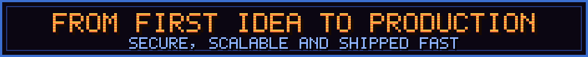
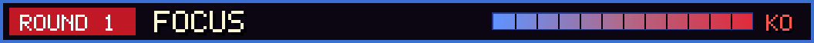
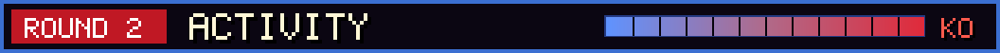
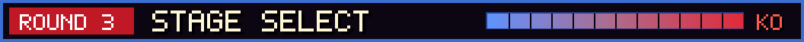
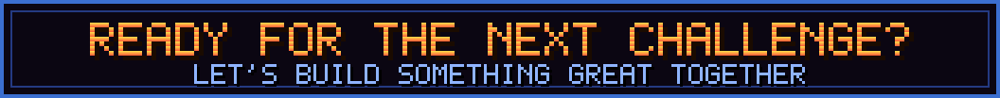

<!--THEME:START-->

<!--THEME:END-->

 
 

&nbsp;&nbsp;&nbsp;&nbsp;&nbsp;&nbsp;&nbsp;&nbsp;&nbsp;&nbsp;&nbsp;&nbsp;

 

### Player 1

I am a **software engineer and entrepreneur**. I design, ship and secure software end to end: architecture, DevOps and SecOps pipelines, AWS cloud and AI agents built with Claude. I also build products and technology-driven businesses, from the first idea to a running company.

 **Base:** Goiânia, Goiás, Brasil
 
**Languages:**  Portuguese (Native) &nbsp;  English (Fluent) &nbsp;  Spanish &nbsp;  German (A2–B1)

 

 

 

 

 

**Beyond the code:** Street Fighter, dark fantasy RPGs (Elden Ring, Diablo, Path of Exile, Dark Souls), anime, rock and metal, and skate.

(c) 2026 Thiago Falcone. All rights reserved. This layout, text and artwork are original work and are not licensed for copying or reuse. See [LICENSE](LICENSE) and [CREDITS](CREDITS.md).
