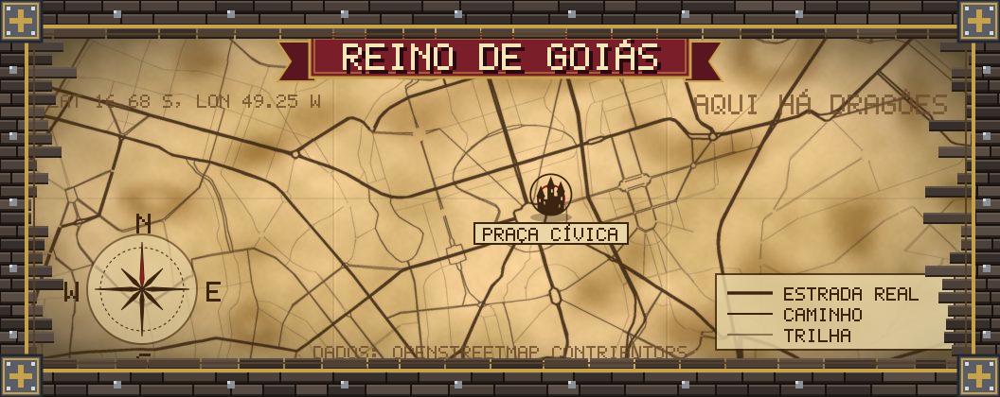
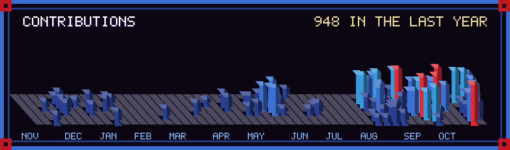

<!--THEME:START-->

<!--THEME:END-->

##  The Hero

  

 

**Thiago Matheus Onorio Ribeiro Pinheiro**, Software Engineer • AI Solutions • Software Architecture • Product Engineering • Technical Leadership.

Building scalable products, intelligent systems and technology-driven businesses. Cloud deployments, AI integration, workflow automation and end-to-end product development, with a Les Paul within reach and a skateboard by the door. 🎸🛹

📍 **Goiânia, Goiás, Brasil** 

**Languages spoken:**  Portuguese (Native) •  English (Fluent) •  Spanish •  German (A2–B1)

##  The Inventory

**Focus:** Software Architecture • Artificial Intelligence • Product Development • System Design • Cloud Solutions • Workflow Automation • Technical Leadership • Innovation Strategy • Digital Transformation

### 🔮 Spellbook: AI & Automation

### ⚒️ The Forge: Cloud, DevOps & Platforms

### 🗡️ Weapons: Technology Ecosystem

##  Side Quests

  

##  The Homeland

**Goiânia, Goiás, Brasil**  The base camp where every quest starts.

  

##  The Kingdom

### 🚀 Current Quests

- 🤖 Building AI-powered products
- 🏗️ Designing scalable architectures
- ⚙️ Intelligent automation with n8n
- ☁️ Cloud-native applications
- 💡 Product strategy and innovation

##  The Stage

<!--QUOTE:START-->

<!--QUOTE:END-->

<!--FOOTER:START-->

<!--FOOTER:END-->
